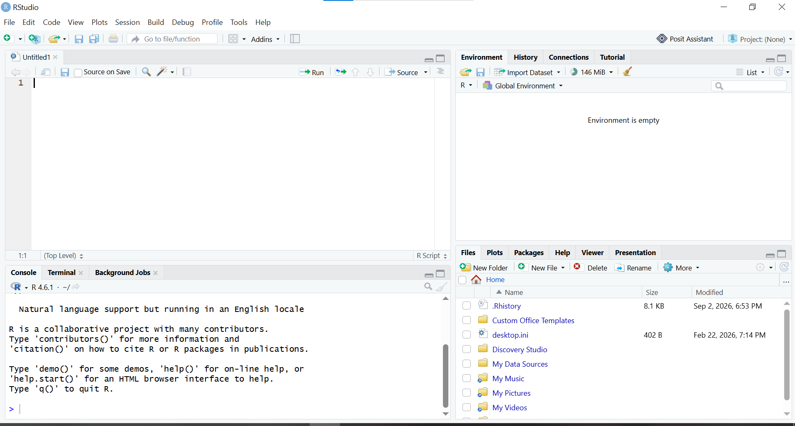
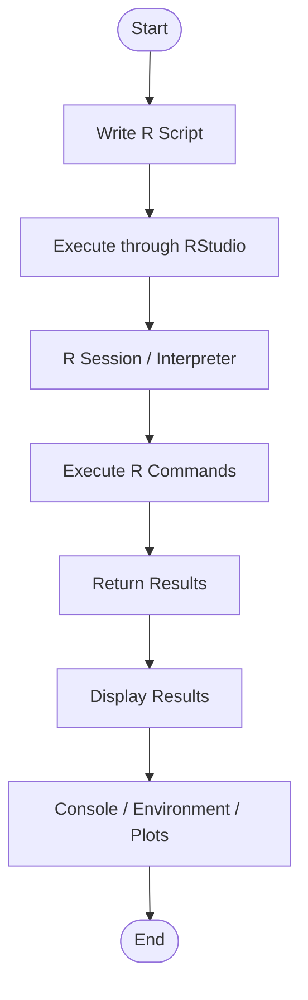

# Module 1: R Programming

## Session 1: Introduction to R & RStudio

## 1. Objectives

- Install R and RStudio.
- Understand R execution flow.
- Work with variables and basic data types.
- Perform basic input/output operations.

## 2. Major Uses and Advantages of R

- Used in statistics and bioinformatics.
- Open-source programming language.
- Extensive packages available, such as `ggplot2` (used for data visualisation).
- Widely used for statistical computing, data analysis and visualisation.
- Useful for analysing biological and genomic datasets.

## 3. Downloading R and RStudio

- R can be downloaded using CRAN (Comprehensive R Archive Network).
- RStudio is available from Posit.

**Difference between R and RStudio:**

| Software | Function |
|---|---|
| R | Programming language and interpreter/runtime environment |
| RStudio | Integrated Development Environment (IDE) used to write, execute and manage R code |

RStudio provides an interface through which users interact with an R session.

## 4. RStudio Interface (Interactive Window)

The RStudio interface consists of four major panels:

| RStudio Panel | Function |
|---|---|
| Script Editor | Write and edit R code |
| Console | Execute commands and view outputs |
| Environment | Display stored objects, variables and datasets |
| Plots Panel | Display graphs and visualisations |



### To Run a Command

- Press `Ctrl + Enter` → Executes the selected line or highlighted code in the script editor.
- Alternatively, click the Run button (play icon) in the editor.
- Commands can also be entered directly into the Console.

## 5. R Execution Flow

### Assignment Operator

- R uses the assignment operator `<-` to assign values to objects.
- `x <- 10` means the value 10 is assigned to the object named `x`.
- R executes statements sequentially when running a script.
- R is a case-sensitive programming language.
- R uses the concept of objects.

**Example:**

```r
x <- 10
```

The value 10 is assigned to `x`.

Another valid assignment operator is `->` (rightward assignment):

```r
10 -> x
```

However, `<-` is the commonly used convention in R programming.

### Objects and Variables

- An object is an entity stored in R, containing data or other information.
- A variable name is a name used to refer to an object.
- Objects can store values such as strings, numbers, logical values and other data structures.
- R is dynamically typed, meaning an object name can be reassigned to a value of a different data type.
- R reports errors when invalid syntax or incompatible operations are encountered.

**Example:**

```r
age <- "Deepti"
```

The object named `age` stores the character value `"Deepti"`.

The object can be viewed in the Environment panel in RStudio.

### Example of Dynamic Typing

```r
x <- 10
class(x)

x <- "Hello"
class(x)
```

Initially, `x` refers to a numeric object. After reassignment, it refers to a character object.

This demonstrates dynamic typing in R.

### Simplified R Execution Workflow

```text
R Script
   |
   v
RStudio IDE
   |
   v
R Session / Interpreter
   |
   v
Code Execution
   |
   v
Results returned to RStudio
   |
   v
Console / Environment / Plots
```

The RStudio IDE sends code to an R session, which executes the commands and returns the results to the appropriate interface panels.

## 6. Basic Data Types and Data Structures in R

R supports different data types and data structures.

### Basic Data Types

| Data Type | Description | Example |
|---|---|---|
| Numeric | Used for decimal and real numbers | `10.5` |
| Integer | Used for whole numbers | `10L` |
| Character | Used for text | `"Biology"` |
| Logical | Used for TRUE/FALSE values | `TRUE` |
| Complex | Used for complex numbers | `2+3i` |
| Raw | Used to represent raw bytes | `charToRaw("A")` |

### Common Data Structures

| Data Structure | Description |
|---|---|
| Vector | One-dimensional collection of elements of the same basic type |
| Matrix | Two-dimensional structure containing elements of the same basic type |
| Array | Multidimensional structure containing elements of the same basic type |
| List | Collection that can contain elements of different data types and structures |
| Data Frame | Two-dimensional tabular structure in which columns can contain different data types |
| Factor | Used to represent categorical data |

**Important Distinction:**

Data types and data structures are not the same.

- Data types describe the kind of values stored.
- Data structures describe how those values are organised.

More data structures and their applications will be covered in upcoming sessions.

### Checking the Data Type of an Object

We can use the `class()` function to identify the class of an object.

```r
x <- 10
class(x)
```

Other useful functions:

```r
typeof(x)   # Identifies the internal storage type
class(x)    # Identifies the object's class
str(x)      # Displays the object's structure
```

## 7. Basic Inbuilt Input and Output Functions

| Function | Purpose |
|---|---|
| `readline()` | Accepts user input and stores it as a character string |
| `print()` | Displays an R object |
| `cat()` | Concatenates and displays values or text |

**Example:**

```r
name <- readline("Enter name: ")

print(name)

cat("Hello", name)
```

**Note:** R is case-sensitive. Function names must be written correctly using lowercase letters, such as `readline()` and `cat()`.

## 8. Libraries and Packages

- A package is a collection of R functions, datasets and documentation.
- A library can refer to a collection of installed packages or the directory where packages are stored.
- The `library()` function is used to load an installed package into the current R session.

One of the most commonly used collections of packages in data analysis and bioinformatics is **tidyverse**.

Tidyverse is used for data manipulation, data visualisation and data handling.

### Commonly Used Packages

| Package | Description |
|---|---|
| `readr` | Reads CSV and other rectangular data files |
| `dplyr` | Filtering, selecting and transforming data |
| `ggplot2` | Creating graphs and plots |
| `tibble` | Provides an improved data frame structure |
| `readxl` | Reads Excel spreadsheets |

**Note:** `readxl` is commonly used alongside tidyverse, but it is not included in the core tidyverse package collection.

### Loading Tidyverse

```r
library(tidyverse)

search()  # Lists the current search path, including attached packages
```

The `library(tidyverse)` command loads the core tidyverse packages.

## 9. Built-in R Datasets

R provides built-in datasets through packages such as `datasets`. These datasets can be used for practising data analysis and statistical operations.

### 1. mtcars

- A built-in dataset containing information about different car models.
- Can be loaded using:

```r
data(mtcars)
```

- To display the first five rows:

```r
head(mtcars)
```

- To display the first ten rows:

```r
head(mtcars, 10)
```

- To view the structure:

```r
str(mtcars)
```

- To view dimensions:

```r
dim(mtcars)
```

### 2. iris

- A built-in dataset containing measurements of three species of iris flowers.
- Contains sepal length, sepal width, petal length and petal width.
- Useful for practising data visualisation and classification.

Load the dataset:

```r
data(iris)

head(iris)
str(iris)
```

**Note:** RStudio allows us to explore loaded datasets through the Environment panel. The Environment panel displays stored objects, while dataset documentation can be accessed separately through R help and documentation tools.

## 10. Creating Vectors and Data Frames in R

### Vector → One-dimensional Structure

A vector is a one-dimensional collection of elements of the same basic data type.

This is somewhat similar to a list in Python, although Python lists can contain different data types within the same list.

**Example:**

```r
Variable <- c(1, 2, 3, 4, 5)
```

- The `c()` function means combine.
- It combines multiple values into a single vector.
- The values are stored as elements of the same vector.

### Data Frame → Two-dimensional Tabular Structure

- A data frame is a two-dimensional tabular structure.
- It consists of rows and columns.
- Each column represents a variable.
- Each row represents an observation.
- Different columns can contain different data types.
- A data frame is commonly constructed using vectors of equal length.

**Example:**

```r
gene.data <- data.frame(
  sample_ID = c("s1", "s2", "s3", "s4", "s5"),
  Treatment = c("control", "placebo", "drugA", "drugB", "drugC"),
  Expression_levels = c(5.2, 4.8, 5.5, 7.1, 8.2)
)
```

In the above code:

| Variable (Column) | Observations (Rows) |
|---|---|
| `sample_ID` | s1, s2, s3, s4, s5 |
| `Treatment` | control, placebo, drugA, drugB, drugC |
| `Expression_levels` | 5.2, 4.8, 5.5, 7.1, 8.2 |

**Important Observations:**

- Values within an atomic vector should have the same basic data type.
- Different vectors within a data frame can have different data types.
- Vectors used to construct a standard data frame must have compatible lengths.
- Data frames can contain missing values, represented by `NA`.
- Missing values do not automatically prevent a data frame from being created.

**Example of a Data Frame Containing Missing Values:**

```r
gene.data <- data.frame(
  Sample = c("S1", "S2", "S3"),
  Expression = c(5.2, NA, 7.1)
)
```

Here, `NA` represents a missing value.

## 11. Basic Calculations Using R

R can perform arithmetic operations such as addition, subtraction, multiplication, division and exponentiation.

**Example:**

```r
a <- 15
b <- 4

c <- a + b  # Addition
d <- a / b  # Division
e <- a ^ b  # Exponentiation

# Print results
print(c)
print(d)
print(e)

# Display data types
class(c)
class(d)
class(e)
```

**Expected Outputs:**

| Object | Operation | Result |
|---|---|---|
| c | 15 + 4 | 19 |
| d | 15 / 4 | 3.75 |
| e | 15 ^ 4 | 50625 |

Multiple values can also be displayed together using:

```r
cat(c, d, e)
```

**Note:** `print()` is generally used to display individual objects, while `cat()` is useful for combining and displaying multiple values or text.

## 12. Converting Data Types

To convert data from one type to another, R provides type-conversion functions beginning with `as.`.

**Common Examples:**

| Function | Conversion |
|---|---|
| `as.numeric()` | Converts to numeric |
| `as.integer()` | Converts to integer |
| `as.character()` | Converts to character |
| `as.logical()` | Converts to logical |

**Example:**

```r
temperature <- 37.5

temperature_character <- as.character(temperature)

class(temperature_character)
```

**Output:**

```text
[1] "character"
```

Type conversion is also known as coercion in R.

**Note:** Not every value can be successfully converted into every data type. For example, converting non-numeric text into a numeric value may produce `NA` with a warning.

## 13. Input Functions

`readline()` can be used to accept dynamic user input, while `cat()` can display the resulting output.

**Example:**

```r
name <- readline("Enter your name: ")

cat("Hello", name)
```

The `readline()` function returns user input as a character string.

## 14. Dynamic Typing

Dynamic typing refers to the ability of a programming language to determine and handle the type of an object during execution.

In R, an object name can be reassigned to a value of a different data type.

**Example:**

```r
x <- 10

class(x)

x <- "Hello"

class(x)
```

Initially, `x` is numeric. After reassignment, `x` is character.

This is one of the characteristics of dynamically typed programming languages.

## 15. Dataset-related Commands

The following commands are useful when exploring datasets in R.

| Command | Function |
|---|---|
| `data(mtcars)` | Loads the mtcars dataset |
| `head(mtcars)` | Displays the first six rows |
| `head(mtcars, 10)` | Displays the first ten rows |
| `str(mtcars)` | Displays the structure of the dataset |
| `dim(mtcars)` | Displays the number of rows and columns |
| `class(mtcars)` | Displays the object's class |
| `summary(mtcars)` | Provides a statistical summary of the dataset |
| `tail(mtcars)` | Displays the last six rows |

**Understanding the Commands:**

- `head()` → Helps inspect the first few observations.
- `str()` → Displays the structure, column names, data types and sample values.
- `dim()` → Returns the dimensions in rows × columns format.
- `summary()` → Provides summary statistics for the dataset.

## 16. Important Observations from Session 1

- R is a case-sensitive programming language.
- R uses `<-` as its commonly used assignment operator.
- Objects store data and are accessed using variable names.
- R is dynamically typed.
- Vectors generally contain elements of the same basic data type.
- Data frames organise information into rows and columns.
- Different columns in a data frame can have different data types.
- Missing values are represented by `NA`.
- `readline()` accepts user input as character data.
- `print()` and `cat()` are commonly used for displaying output.
- Packages extend the functionality of R.
- RStudio is an IDE, whereas R is the programming language and execution environment.

## 17. R Execution Workflow – Flowchart



## 18. Questions and Concepts to Revisit

- Difference between vectors, lists, matrices and data frames.
- Difference between objects and variables.
- Difference between `class()` and `typeof()`.
- How does R handle missing values?
- What is the difference between a package and a library?
- How does type coercion work in R?
- What are the applications of tidyverse in bioinformatics?
- How are datasets explored and manipulated using R?

---

**Session 1 Completion:** Introduction to R and RStudio, basic programming concepts, data types, input/output functions, packages, datasets and basic data frame operations.