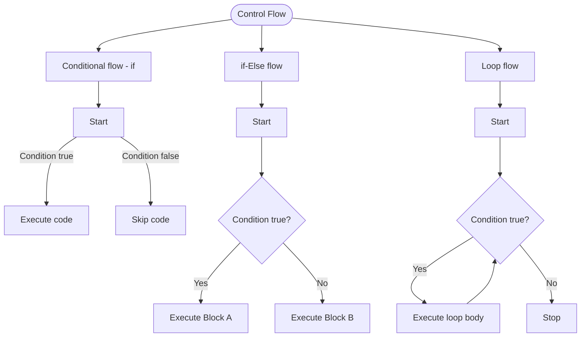

# Module 1: R Programming

## Session 2: Control Flow and Logical Structures

## 1. Objectives

- Understand conditional statements.
- Apply logical operators.
- Implement loops.
- Translate biological problems into structured logic.

---

## 2. Control Flow

- Control flow determines how R makes decisions and repeats actions.
- It controls the order in which instructions are executed in a program.
- It is used to execute specific code depending on conditions or to repeat a set of instructions.

### Types of Control Flow

1. Conditional statements
   - `if`
   - `if-else`
   - `else if`
2. Loop statements
   - `for`
   - `while`
   - `repeat`
3. Loop control statements
   - `break`
   - `next`

### Control Flow Diagram



---

# PART A: CONDITIONAL STATEMENTS

## 3. if Statement

### Definition

- The `if` statement is used to execute a block of code only when a specified condition is TRUE.
- If the condition is FALSE, the code inside the `if` block is skipped.

### Syntax

```r
if (condition) {
  # Code to execute if condition is TRUE
}
```

### Example 1: Checking age

```r
age <- 25

if (age >= 18) {
  print("Adult")
}
```

**Output:**
```text
[1] "Adult"
```

**Explanation:**
- `age <- 25` assigns the value 25 to the variable.
- `age >= 18` checks whether age is greater than or equal to 18.
- Since the condition is TRUE, R executes the code inside the `if` block.

### Example 2: Checking whether a sample has sufficient concentration

```r
concentration <- 15

if (concentration >= 10) {
  print("Sample accepted")
}
```

**Output:**
```text
[1] "Sample accepted"
```

**Where to use:**
- Checking whether a biological sample meets a specified threshold.
- Checking whether a measurement is above or below a reference value.

*Note: The concentration threshold here is illustrative, not a universal laboratory standard.*

### Example 3: Checking gene expression

```r
gene_expression <- 8.5

if (gene_expression > 5) {
  print("High gene expression")
}
```

**Output:**
```text
[1] "High gene expression"
```

**Where to use:**
- Checking whether gene expression exceeds a selected threshold.
- Identifying samples that meet a particular experimental criterion.

---

## 4. if-else Statement

### Definition

- The `if-else` statement is used when there are two possible outcomes.
- If the condition is TRUE, the `if` block executes.
- If the condition is FALSE, the `else` block executes.

### Syntax

```r
if (condition) {
  # Executes if TRUE
} else {
  # Executes if FALSE
}
```

### Example 1: Checking age

```r
age <- 16

if (age >= 18) {
  print("Adult")
} else {
  print("Minor")
}
```

**Output:**
```text
[1] "Minor"
```

### Example 2: Checking odd or even numbers

```r
num <- 4

if (num %% 2 == 0) {
  print("Even")
} else {
  print("Odd")
}
```

**Output:**
```text
[1] "Even"
```

**Explanation:**
- `%%` is the modulus operator.
- It returns the remainder after division.
- `num %% 2` checks the remainder when the number is divided by 2.
- `==` checks whether two values are equal.
- If the remainder is 0, the number is even.

### Example 3: Checking sample quality

```r
quality_score <- 75

if (quality_score >= 70) {
  print("Good quality")
} else {
  print("Poor quality")
}
```

**Where to use:**
- Classifying samples based on quality scores.
- Checking whether a sample passes or fails a selected quality threshold.

*Note: The threshold is illustrative and depends on the experiment.*

---

## 5. else if Statement

### Definition

- `else if` is used when there are multiple conditions to check.
- R evaluates the conditions from top to bottom.
- The first condition that evaluates to TRUE is executed.
- If none of the conditions is TRUE, the final `else` block executes.

### Syntax

```r
if (condition1) {
  # Code for condition 1
} else if (condition2) {
  # Code for condition 2
} else {
  # Code if all conditions are FALSE
}
```

### Example 1: Assigning grades

```r
marks <- 85

if (marks >= 90) {
  print("Grade A")
} else if (marks >= 75) {
  print("Grade B")
} else if (marks >= 50) {
  print("Grade C")
} else {
  print("Fail")
}
```

**Output:**
```text
[1] "Grade B"
```

### Example 2: Classifying gene expression levels

```r
expression <- 8

if (expression >= 10) {
  print("High expression")
} else if (expression >= 5) {
  print("Moderate expression")
} else {
  print("Low expression")
}
```

**Output:**
```text
[1] "Moderate expression"
```

**Where to use:**
- Classifying gene expression into different groups.
- Categorising samples based on concentration.
- Classifying experimental results into multiple categories.

*Note: Expression thresholds are illustrative and must be defined according to the experiment.*

### Example 3: Classifying bacterial growth

```r
growth <- 0.8

if (growth >= 1.5) {
  print("High growth")
} else if (growth >= 0.5) {
  print("Moderate growth")
} else {
  print("Low growth")
}
```

---

## 6. Nested if Statements

### Definition

- A nested `if` statement is an `if` statement placed inside another `if` statement.
- It is used when a second condition needs to be checked only after the first condition is satisfied.

### Example: Checking sample acceptance and quality

```r
sample_available <- TRUE
quality_score <- 85

if (sample_available == TRUE) {
  if (quality_score >= 70) {
    print("Sample accepted")
  } else {
    print("Sample rejected - poor quality")
  }
} else {
  print("Sample unavailable")
}
```

**Output:**
```text
[1] "Sample accepted"
```

**Where to use:**
- Checking sample availability before checking sample quality.
- Performing multiple dependent checks in laboratory workflows.

---

# PART B: LOGICAL OPERATORS

## 7. Logical Operators

### Definition

Logical operators are used to combine or modify conditions.

They return logical values:
- `TRUE`
- `FALSE`

### Main Logical Operators

| Operator | Meaning | Function |
|---|---|---|
| `&&` | AND | TRUE only when both conditions are TRUE |
| `||` | OR | TRUE when at least one condition is TRUE |
| `!` | NOT | Reverses TRUE to FALSE and FALSE to TRUE |

### 7.1 AND Operator (`&&`)

- Both conditions must be TRUE for the overall result to be TRUE.
- If either condition is FALSE, the result is FALSE.

**Example 1: Checking eligibility**

```r
age <- 25

if (age > 18 && age < 60) {
  print("Eligible")
} else {
  print("Not eligible")
}
```

**Output:**
```text
[1] "Eligible"
```

**Explanation:**
- `age > 18` is TRUE.
- `age < 60` is TRUE.
- Both conditions are TRUE, so the final result is TRUE.

**Example 2: Checking sample conditions**

```r
temperature <- 37
pH <- 7

if (temperature >= 35 && pH >= 6.5) {
  print("Conditions satisfied")
} else {
  print("Conditions not satisfied")
}
```

**Where to use:**
- When multiple requirements must be satisfied simultaneously.
- Checking whether experimental conditions fall within selected ranges.

*Note: These are illustrative values, not universal experimental conditions.*

### 7.2 OR Operator (`||`)

- At least one condition must be TRUE for the overall result to be TRUE.
- Both conditions can also be TRUE.

**Example 1: Checking eligibility**

```r
marks <- 85

if (marks >= 90 || marks >= 75) {
  print("Qualified")
} else {
  print("Not qualified")
}
```

**Output:**
```text
[1] "Qualified"
```

**Example 2: Checking sample identification**

```r
sample_type <- "blood"

if (sample_type == "blood" || sample_type == "tissue") {
  print("Valid sample type")
} else {
  print("Invalid sample type")
}
```

**Where to use:**
- When one of several possible conditions is sufficient.
- Accepting multiple sample types or alternative criteria.

### 7.3 NOT Operator (`!`)

- The NOT operator reverses a logical value.
- TRUE becomes FALSE.
- FALSE becomes TRUE.

**Example 1:**

```r
x <- TRUE

print(!x)
```

**Output:**
```text
[1] FALSE
```

**Example 2: Checking whether a sample is not contaminated**

```r
contaminated <- FALSE

if (!contaminated) {
  print("Sample is not contaminated")
} else {
  print("Sample is contaminated")
}
```

**Output:**
```text
[1] "Sample is not contaminated"
```

**Where to use:**
- Checking whether a condition is absent.
- Excluding samples that meet a particular condition.

### 7.4 Comparison Operators Used in Conditions

| Operator | Meaning | Example |
|---|---|---|
| `==` | Equal to | `x == 5` |
| `!=` | Not equal to | `x != 5` |
| `>` | Greater than | `x > 5` |
| `<` | Less than | `x < 5` |
| `>=` | Greater than or equal to | `x >= 5` |
| `<=` | Less than or equal to | `x <= 5` |

**Important difference:**

```r
x <- 5
```

`<-` assigns a value.

```r
x == 5
```

`==` checks whether two values are equal.

### 7.5 Difference Between `&&` and `&`

- `&&` evaluates only the first element of each logical vector. It is commonly used in `if` conditions.
- `&` compares corresponding elements of logical vectors and returns a logical vector.
- Similarly, `||` checks the first elements, whereas `|` works element by element.

**Example:**

```r
x <- c(5, 10, 15)

x > 5
```

**Output:**
```text
[1] FALSE TRUE TRUE
```

```r
x > 5 & x < 15
```

**Output:**
```text
[1] FALSE TRUE FALSE
```

**Where to use:**
- Use `&&` and `||` for single TRUE/FALSE decisions.
- Use `&` and `|` when applying conditions to multiple values in a vector or dataset.

---

# PART C: LOOPS

## 8. Loops

### Definition

- Loops are used to execute a block of code repeatedly.
- They reduce the need to write the same instructions multiple times.
- They are useful when processing multiple values, samples, genes or experimental observations.

### Types of Loops in R

1. `for` loop
2. `while` loop
3. `repeat` loop

---

## 9. for Loop

### Definition

- A `for` loop is used when the number of iterations is known or when iterating over a defined sequence or collection of values.
- It executes the code once for each value in the sequence.

### Syntax

```r
for (variable in sequence) {
  # Code to execute
}
```

### Example 1: Printing numbers

```r
for (i in 1:5) {
  print(i)
}
```

**Output:**
```text
[1] 1
[1] 2
[1] 3
[1] 4
[1] 5
```

**Explanation:**
- `i` is the loop variable.
- `1:5` creates a sequence from 1 to 5.
- The loop executes five times.
- During each iteration, `i` takes the next value.

### Example 2: Printing names

```r
names <- c("GeneA", "GeneB", "GeneC")

for (gene in names) {
  print(gene)
}
```

**Output:**
```text
[1] "GeneA"
[1] "GeneB"
[1] "GeneC"
```

### Example 3: Calculating squares

```r
for (i in 1:5) {
  print(i^2)
}
```

**Output:**
```text
[1] 1
[1] 4
[1] 9
[1] 16
[1] 25
```

### Example 4: Processing biological samples

```r
samples <- c("Sample1", "Sample2", "Sample3")

for (sample in samples) {
  print(paste("Processing", sample))
}
```

**Output:**
```text
[1] "Processing Sample1"
[1] "Processing Sample2"
[1] "Processing Sample3"
```

### Example 5: Calculating total expression

```r
expression <- c(5, 10, 15, 20)
total <- 0

for (value in expression) {
  total <- total + value
}

print(total)
```

**Output:**
```text
[1] 50
```

**Explanation:**
- `total <- 0` creates an initial value.
- Each expression value is added to `total`.
- After all iterations, the total is printed.

**Where to use:**
- Processing multiple biological samples.
- Iterating through gene names.
- Performing repeated calculations.
- Applying the same operation to multiple experimental observations.

---

## 10. while Loop

### Definition

- A `while` loop executes a block of code as long as a specified condition remains TRUE.
- The condition is checked before every iteration.
- The loop stops when the condition becomes FALSE.

### Syntax

```r
while (condition) {
  # Code to execute
}
```

### Example 1: Printing numbers

```r
count <- 1

while (count <= 5) {
  print(count)
  count <- count + 1
}
```

**Output:**
```text
[1] 1
[1] 2
[1] 3
[1] 4
[1] 5
```

**Explanation:**
- `count <- 1` sets the starting value.
- `count <= 5` checks the condition.
- `print(count)` displays the current value.
- `count <- count + 1` increases the value by one.
- Once count becomes 6, the condition is FALSE and the loop stops.

### Example 2: Repeating until a threshold is reached

```r
concentration <- 2

while (concentration < 10) {
  print(concentration)
  concentration <- concentration + 2
}
```

**Output:**
```text
[1] 2
[1] 4
[1] 6
[1] 8
```

### Example 3: Increasing a value until a target is reached

```r
growth <- 0

while (growth < 5) {
  growth <- growth + 1
  print(growth)
}
```

**Where to use:**
- When the number of iterations is not known in advance.
- Repeating a process until a condition is met.
- Iterative calculations and simulations.

**Important:** Always make sure the condition can eventually become FALSE. Otherwise, the loop may run indefinitely.

---

## 11. repeat Loop

### Definition

- The `repeat` loop executes a block of code continuously.
- It does not have a condition at the beginning.
- It continues until a `break` statement is encountered.

### Syntax

```r
repeat {
  # Code to execute

  if (condition) {
    break
  }
}
```

### Example 1: Printing numbers

```r
count <- 1

repeat {
  print(count)
  count <- count + 1

  if (count > 5) {
    break
  }
}
```

**Output:**
```text
[1] 1
[1] 2
[1] 3
[1] 4
[1] 5
```

### Example 2: Repeating until a threshold is reached

```r
value <- 0

repeat {
  value <- value + 2
  print(value)

  if (value >= 10) {
    break
  }
}
```

**Where to use:**
- When a process needs to continue until a stopping condition is met.
- When the stopping condition is checked after executing the loop body.

**Important:** A `repeat` loop needs a suitable stopping condition and `break`. Otherwise, it can run indefinitely.

---

## 12. Difference Between for, while and repeat Loops

| Feature | for | while | repeat |
|---|---|---|---|
| Main use | Iterating over a sequence | Repeating while a condition is TRUE | Repeating until stopped |
| Condition | Uses a sequence | Checked before each iteration | No initial condition |
| Number of iterations | Usually known from sequence | May be unknown | May be unknown |
| Stopping | Sequence ends | Condition becomes FALSE | `break` is executed |

### Quick Selection Guide

- Use `for` when iterating over a known collection of values.
- Use `while` when repeating as long as a condition is TRUE.
- Use `repeat` when you want to keep executing until a stopping condition is reached.

---

# PART D: LOOP CONTROL STATEMENTS

## 13. break Statement

### Definition

- `break` immediately terminates the current loop.
- It stops further iterations even if the loop condition is still TRUE.

### Example 1: Stop at number 3

```r
for (i in 1:5) {
  if (i == 3) {
    break
  }

  print(i)
}
```

**Output:**
```text
[1] 1
[1] 2
```

**Explanation:**
- The loop starts from 1.
- When `i` becomes 3, the `break` statement is executed.
- The loop terminates immediately.

### Example 2: Stop processing when a particular sample is found

```r
samples <- c("S1", "S2", "S3", "S4")

for (sample in samples) {
  if (sample == "S3") {
    break
  }

  print(sample)
}
```

**Output:**
```text
[1] "S1"
[1] "S2"
```

**Where to use:**
- Stopping a search when a required value is found.
- Terminating a loop when a specified condition is met.
- Preventing unnecessary iterations.

---

## 14. next Statement

### Definition

- `next` skips the current iteration of a loop.
- It moves directly to the next iteration.
- Unlike `break`, it does not terminate the entire loop.

### Example 1: Skip number 3

```r
for (i in 1:5) {
  if (i == 3) {
    next
  }

  print(i)
}
```

**Output:**
```text
[1] 1
[1] 2
[1] 4
[1] 5
```

### Example 2: Skip a particular sample

```r
samples <- c("S1", "S2", "S3", "S4")

for (sample in samples) {
  if (sample == "S3") {
    next
  }

  print(sample)
}
```

**Output:**
```text
[1] "S1"
[1] "S2"
[1] "S4"
```

### Example 3: Skip missing values

```r
expression <- c(5, 10, NA, 20)

for (value in expression) {
  if (is.na(value)) {
    next
  }

  print(value)
}
```

**Output:**
```text
[1] 5
[1] 10
[1] 20
```

**Where to use:**
- Skipping missing values.
- Excluding unwanted observations.
- Ignoring samples that do not meet a particular criterion.

### Difference Between break and next

| break | next |
|---|---|
| Terminates the entire loop | Skips only the current iteration |
| No further iterations occur | The next iteration continues |
| Used to stop a loop | Used to skip selected values |

---

# PART E: MATHEMATICAL OPERATORS USED IN CONDITIONS

## 15. Modulus Operator (`%%`)

### Definition

- The modulus operator `%%` returns the remainder after division.
- It is commonly used to check whether a number is odd or even.
- It can also be used to identify values at regular intervals.

### Syntax

```r
number %% divisor
```

### Example 1: Checking odd or even numbers

```r
num <- 4

if (num %% 2 == 0) {
  print("Even")
} else {
  print("Odd")
}
```

**Output:**
```text
[1] "Even"
```

**Explanation:**
- `num %% 2` divides the number by 2 and returns the remainder.
- `== 0` checks whether the remainder is zero.
- If the remainder is zero, the number is even.
- Otherwise, the number is odd.

### Example 2: Checking multiples of 5

```r
num <- 25

if (num %% 5 == 0) {
  print("Multiple of 5")
} else {
  print("Not a multiple of 5")
}
```

**Output:**
```text
[1] "Multiple of 5"
```

### Example 3: Identifying every second sample

```r
for (i in 1:6) {
  if (i %% 2 == 0) {
    print(paste("Even sample number:", i))
  }
}
```

**Output:**
```text
[1] "Even sample number: 2"
[1] "Even sample number: 4"
[1] "Even sample number: 6"
```

### Where to use

- Identifying odd and even numbers.
- Finding multiples of a number.
- Selecting observations at regular intervals.
- Applying operations to every second, third or fifth observation.

---

## 16. Other Mathematical Operators in R

| Operator | Meaning | Example | Result |
|---|---|---|---|
| `+` | Addition | `5 + 2` | 7 |
| `-` | Subtraction | `5 - 2` | 3 |
| `*` | Multiplication | `5 * 2` | 10 |
| `/` | Division | `10 / 2` | 5 |
| `^` | Power | `2 ^ 3` | 8 |
| `%%` | Remainder | `10 %% 3` | 1 |
| `%/%` | Integer division | `10 %/% 3` | 3 |

---

# PART F: ADDITIONAL USEFUL R CONCEPTS

## 17. ifelse() Function

### Definition

- `ifelse()` is a vectorised conditional function.
- It checks a condition and returns one value when TRUE and another when FALSE.
- It is useful for applying a condition to multiple values at once.

### Syntax

```r
ifelse(condition, value_if_true, value_if_false)
```

### Example 1: Classifying numbers

```r
numbers <- c(2, 5, 8, 11)

result <- ifelse(numbers %% 2 == 0, "Even", "Odd")

print(result)
```

**Output:**
```text
[1] "Even" "Odd" "Even" "Odd"
```

### Example 2: Classifying gene expression

```r
expression <- c(2, 6, 9, 3)

result <- ifelse(expression >= 5, "High", "Low")

print(result)
```

**Output:**
```text
[1] "Low" "High" "High" "Low"
```

**Where to use:**
- Categorising multiple observations.
- Creating new classification columns in datasets.
- Applying the same TRUE/FALSE decision to a vector.

**Difference between if and ifelse():**

| if | ifelse() |
|---|---|
| Works with a single logical condition | Can work with multiple logical values |
| Executes a block of code | Returns values based on a condition |
| Used for program flow | Used for vectorised conditional operations |

---

## 18. Combining Loops and Conditional Statements

Conditional statements can be placed inside loops to make decisions during each iteration.

### Example: Classifying multiple gene expression values

```r
expression <- c(2, 6, 12, 4, 15)

for (value in expression) {

  if (value >= 10) {
    print("High expression")

  } else if (value >= 5) {
    print("Moderate expression")

  } else {
    print("Low expression")
  }
}
```

**Output:**
```text
[1] "Low expression"
[1] "Moderate expression"
[1] "High expression"
[1] "Low expression"
[1] "High expression"
```

**Explanation:**
- The `for` loop takes one expression value at a time.
- The `if-else` statements classify each value.
- The process repeats until all values are checked.

**Where to use:**
- Analysing multiple gene expression values.
- Classifying samples.
- Applying quality checks to experimental data.

---

## 19. Useful Biological and Bioinformatics Applications

| Problem | R concept to use | Example application |
|---|---|---|
| Check sample quality | `if-else` | Pass or fail a quality threshold |
| Classify gene expression | `if-else` | High, moderate or low expression |
| Process multiple genes | `for` | Iterate through gene names |
| Process multiple samples | `for` | Perform the same operation on each sample |
| Repeat until a target is reached | `while` | Iterative calculations |
| Skip missing observations | `next` | Ignore `NA` values |
| Stop processing | `break` | Stop when a target is found |
| Categorise multiple values | `ifelse()` | Create expression categories |
| Check multiple requirements | `&&` | Check multiple experimental conditions |
| Check alternative conditions | `||` | Accept different sample types |

---

# PART G: COMMON ERRORS AND IMPORTANT POINTS

## 20. Common Mistakes in R Control Flow

### 1. Forgetting to assign a value

Incorrect:

```r
if (age >= 18) {
  print("Adult")
}
```

Correct:

```r
age <- 25

if (age >= 18) {
  print("Adult")
}
```

### 2. Using `=` instead of `==` for comparison

Use `==` to check equality.

```r
x <- 5

if (x == 5) {
  print("Equal")
}
```

### 3. Forgetting to update the while loop variable

Incorrect:

```r
count <- 1

while (count <= 5) {
  print(count)
}
```

This creates an infinite loop because count never changes.

Correct:

```r
count <- 1

while (count <= 5) {
  print(count)
  count <- count + 1
}
```

### 4. Forgetting break in repeat

A `repeat` loop continues indefinitely unless it is stopped.

Correct:

```r
count <- 1

repeat {
  print(count)
  count <- count + 1

  if (count > 5) {
    break
  }
}
```

### 5. Using && with a vector when you want element-wise results

For vectors, use `&` instead of `&&` when you want to check every element.

```r
x <- c(5, 10, 15)

x > 5 & x < 15
```

### 6. Handling missing values in conditions

An `NA` value represents missing data. A condition involving `NA` may also return `NA`, which cannot be used directly as the condition of an `if` statement.

Use `is.na()` to check for missing values.

```r
value <- NA

if (is.na(value)) {
  print("Missing value")
} else {
  print("Value available")
}
```

---

# PART H: QUICK REVISION

## 21. Important Syntax to Remember

| Concept | Syntax |
|---|---|
| if | `if (condition) { }` |
| if-else | `if (condition) { } else { }` |
| else if | `else if (condition) { }` |
| AND | `&&` |
| OR | `||` |
| NOT | `!` |
| for loop | `for (i in sequence) { }` |
| while loop | `while (condition) { }` |
| repeat loop | `repeat { }` |
| break | `break` |
| next | `next` |
| Modulus | `%%` |
| Equality | `==` |
| Not equal | `!=` |
| Conditional function | `ifelse(condition, true_value, false_value)` |

## 22. Key Concepts to Explain in an Exam or Interview

1. What is control flow in R?
2. What is the difference between `if` and `if-else`?
3. What is the purpose of `else if`?
4. What are logical operators? Explain AND, OR and NOT.
5. What is the difference between `&&` and `&`?
6. What is a loop? Explain the three types of loops in R.
7. What is the difference between `for` and `while` loops?
8. What is the purpose of the `repeat` loop?
9. What is the difference between `break` and `next`?
10. What is the modulus operator? How can it identify odd and even numbers?
11. What is the difference between `if` and `ifelse()`?
12. How can conditional statements and loops be used in bioinformatics?

---

## 23. Session 2 Completion

By the end of this session, the following concepts should be understood:

- [ ] Conditional statements: `if`, `if-else`, `else if`
- [ ] Nested if statements
- [ ] Logical operators: `&&`, `||`, `!`
- [ ] Comparison operators
- [ ] Difference between `&&` and `&`
- [ ] `for` loop
- [ ] `while` loop
- [ ] `repeat` loop
- [ ] `break` and `next`
- [ ] Modulus operator `%%`
- [ ] `ifelse()` function
- [ ] Combining loops and conditional statements
- [ ] Biological applications of control flow