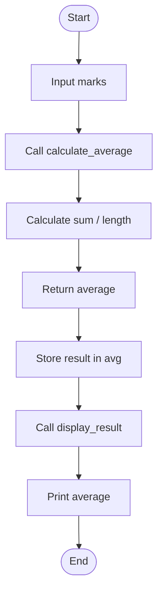

# Module 4: Functions and Modular Programming

## Session 4: Functions and Modular Programming

## 1. Objectives

- Define and call functions.
- Use arguments and return values.
- Understand scope.
- Write modular programs.

---

# PART A: FUNCTIONS

## 2. Functions

### Definition

- A function is a reusable block of code designed to perform a specific task.
- Functions allow us to organise code into smaller, manageable sections.
- A function can be called whenever that particular task needs to be performed.
- Instead of writing the same code repeatedly, we can define it once and reuse it.

### Benefits of Functions

1. **Reusability:** A function can be called multiple times without rewriting the same code.
2. **Improved readability:** Dividing a program into smaller functions makes the code easier to understand.
3. **Reduced redundancy:** Functions prevent unnecessary repetition of code.

### Basic Syntax

```python
def function_name():
    statement
```

**Explanation:**

- `def` is the keyword used to define a function.
- `function_name` is the name given to the function.
- Parentheses `()` are used to specify parameters, if required.
- The colon `:` indicates the beginning of the function body.
- The indented statements form the body of the function.

### Example 1: Creating a Simple Function

```python
def greet():
    print("Hello")
```

Here:

- `def` defines the function.
- `greet` is the function name.
- `print("Hello")` is the statement that executes when the function is called.

**Important:** Defining a function does not execute its code. The function must be called separately.

### Calling a Function

```python
greet()
```

**Output:**

```text
Hello
```

The function executes when `greet()` is called.

### Example 2: Calling a Function Multiple Times

```python
def greet():
    print("Hello")

greet()
greet()
greet()
```

**Output:**

```text
Hello
Hello
Hello
```

The same function can be reused multiple times.

---

## 3. Parameters and Arguments

### Definition

Parameters allow a function to receive input values dynamically.

This means that instead of writing a fixed value inside a function, we can pass different values whenever the function is called.

### Difference Between Parameters and Arguments

- **Parameter:** A variable specified inside the function definition to receive an input.
- **Argument:** The actual value supplied when calling the function.

### Example

```python
def greet(name):
    print("Hello,", name)

greet("Shyam")
```

**Output:**

```text
Hello, Shyam
```

### Explanation

In this example:

- `name` is the parameter.
- `"Shyam"` is the argument.
- When the function is called, the value `"Shyam"` is passed to the parameter `name`.
- The function uses that value in the `print()` statement.

### Passing Different Arguments

```python
def greet(name):
    print("Hello,", name)

greet("Shyam")
greet("Aman")
greet("Deepti")
```

**Output:**

```text
Hello, Shyam
Hello, Aman
Hello, Deepti
```

The same function can produce different outputs depending on the argument supplied.

---

# PART B: RETURN STATEMENT

## 4. Return Statement

### Definition

- The `return` statement sends a value from a function back to the part of the program that called it.
- The returned value can be stored in a variable.
- It can also be used in further calculations or passed to another function.
- A `return` statement also terminates the execution of that function.

### Example 1: Function With Return

```python
def add(a, b):
    return a + b

result = add(5, 3)

print(result)
```

**Output:**

```text
8
```

### Explanation

1. `def add(a, b)` defines a function with two parameters.
2. The function receives the values 5 and 3.
3. `return a + b` calculates their sum.
4. The result is returned to the caller.
5. `result = add(5, 3)` stores the returned value in the variable `result`.
6. `print(result)` displays the result.

The function returns 8, which is then stored in `result`.

### Example 2: Function Without Return

```python
def add(a, b):
    print(a + b)

result = add(5, 3)

print(result)
```

**Output:**

```text
8
None
```

### Explanation

1. The function receives 5 and 3.
2. `print(a + b)` calculates and displays 8.
3. However, the function does not contain a `return` statement.
4. Therefore, Python automatically returns `None`.
5. The variable `result` stores `None`.
6. `print(result)` displays `None`.

### Difference Between print() and return

| print() | return |
|---|---|
| Displays a value on the screen | Sends a value back to the caller |
| Used to show output | Used to provide a result to the program |
| Does not automatically provide a result to the calling code | The returned value can be stored in a variable |
| Does not terminate a function by itself | Ends the function when executed |

**Important:** Printing a value and returning a value are not the same thing.

Use `print()` when you want to display information. Use `return` when you want the function's result to be available for further use.

---

# PART C: ARGUMENT TYPES

## 5. Multiple Arguments (Positional Arguments)

### Definition

- A function can accept multiple parameters.
- When values are passed according to their position, they are called positional arguments.
- The order of the arguments matters because each value is assigned to the corresponding parameter based on its position.

### Example

```python
def student(name, age):
    print(name, age)

student("Shyam", 21)
```

**Output:**

```text
Shyam 21
```

### Explanation

- The function has two parameters: `name` and `age`.
- `"Shyam"` is passed as the first argument.
- `21` is passed as the second argument.
- Therefore, `name` receives `"Shyam"` and `age` receives `21`.

### What Happens if the Order Is Changed?

```python
def student(name, age):
    print(name, age)

student(21, "Shyam")
```

**Output:**

```text
21 Shyam
```

The values are assigned according to their positions, even if the order is not what was intended.

**Important:** Positional arguments depend on the order in which they are supplied.

---

## 6. Default Arguments

### Definition

- A default argument is a value assigned to a parameter during the function definition.
- If no argument is supplied for that parameter when the function is called, Python uses the default value.
- If an argument is supplied, it replaces the default value.

### Syntax

```python
def function_name(parameter="default_value"):
    statement
```

### Example

```python
def greet(name="Guest"):
    print("Hello,", name)
```

### Calling Without an Argument

```python
greet()
```

**Output:**

```text
Hello, Guest
```

Since no argument is provided, Python uses the default value `"Guest"`.

### Calling With an Argument

```python
greet("Shyam")
```

**Output:**

```text
Hello, Shyam
```

The supplied argument replaces the default value.

### Important Points

- Default values are used only when the corresponding argument is not supplied.
- A function can have more than one default parameter.
- Parameters with default values must generally be placed after parameters without default values.

---

## 7. Keyword Arguments

### Definition

- Keyword arguments are supplied using parameter names when calling a function.
- They allow values to be assigned directly to their corresponding parameters.
- Unlike positional arguments, keyword arguments do not depend on the order in which the values are supplied.

### Example

```python
def student(name, age):
    print(name, age)

student(age=21, name="Shyam")
```

**Output:**

```text
Shyam 21
```

### Explanation

- `age=21` assigns 21 directly to the parameter `age`.
- `name="Shyam"` assigns `"Shyam"` directly to the parameter `name`.
- Even though the order is changed, Python assigns the values correctly using their parameter names.

### Difference Between Positional and Keyword Arguments

| Positional Arguments | Keyword Arguments |
|---|---|
| Values are assigned based on position | Values are assigned using parameter names |
| Order matters | Order does not matter when using keyword arguments |
| Example: `student("Shyam", 21)` | Example: `student(age=21, name="Shyam")` |

**Important:** When positional and keyword arguments are used together, positional arguments must come before keyword arguments in the function call.

---

# PART D: SCOPE AND NAMESPACE

## 8. Scope

### Definition

- Scope refers to the region of a program where a variable can be accessed.
- It determines where a variable is available for use.
- In this session, two types of variables are covered: local and global variables.

### 1. Local Variables

**Definition:**

- A local variable is defined inside a function.
- It is generally accessible only within that function.
- It cannot normally be accessed directly outside the function.

### Example

```python
def display():
    x = 5
    print(x)

display()
```

**Output:**

```text
5
```

Here:

- `x` is created inside the function.
- It is a local variable.
- It can be accessed inside `display()`.

### 2. Global Variables

**Definition:**

- A global variable is defined outside a function.
- It can be accessed from different parts of the program, including inside functions, provided it is not shadowed by a local variable with the same name.

### Example: Global and Local Variables

```python
x = 10

def display():
    x = 5
    print(x)

display()

print(x)
```

**Output:**

```text
5
10
```

### Explanation

1. `x = 10` creates a global variable.
2. Inside the function, `x = 5` creates a local variable with the same name.
3. When `display()` is called, Python uses the local variable.
4. Therefore, the function prints 5.
5. Outside the function, `print(x)` accesses the global variable.
6. Therefore, it prints 10.

**Important:** The local variable does not change the global variable. They are separate variables with the same name.

---

## 9. Global Keyword

### Definition

- The `global` keyword allows a function to refer to and modify a global variable.
- It tells Python that a variable inside the function refers to the variable defined at the global level rather than creating a new local variable.

### Example

```python
x = 10

def modify():
    global x
    x = 20

modify()

print(x)
```

**Output:**

```text
20
```

### Explanation

1. `x = 10` creates a global variable.
2. `modify()` is defined.
3. `global x` tells Python that `x` refers to the global variable.
4. `x = 20` changes the value of the global variable.
5. `modify()` calls the function.
6. `print(x)` displays the updated global value, which is 20.

### Difference Between Local and Global Variables

| Local Variable | Global Variable |
|---|---|
| Defined inside a function | Defined outside a function |
| Normally accessible only inside its function | Accessible throughout the module, subject to scope rules |
| Does not directly modify a global variable with the same name | Can be modified inside a function using `global` |

---

## 10. Namespace

### Definition

- A namespace is a collection of names and the objects associated with those names.
- It helps Python identify which variable, function or object a particular name refers to.
- Different scopes can contain names with the same spelling.

### Example

```python
x = 10

def display():
    x = 5
    print(x)

display()
print(x)
```

**Output:**

```text
5
10
```

Here, the name `x` exists in two different namespaces:

- The global namespace contains `x = 10`.
- The local namespace of `display()` contains `x = 5`.

Python uses the appropriate variable depending on where the name is being accessed.

---

# PART E: MODULAR PROGRAMMING

## 11. Modular Programming

### Definition

- Modular programming is the process of breaking a large program into smaller functions or modules.
- Each function is designed to perform a specific task.
- These smaller components can work together to complete a larger program.

### Importance of Modular Programming

1. **Simplifies large programs:** Instead of writing one large block of code, the program is divided into smaller functions.
2. **Improves readability:** Each function has a specific responsibility, making the program easier to understand.
3. **Reduces errors:** Smaller sections of code are easier to check and correct.
4. **Improves reusability:** Functions can be reused in different parts of a program.

### Example: Calculating and Displaying an Average

Consider a program that calculates the average marks of a student.

Instead of performing the calculation and displaying the result in one large block, we can divide the work into two functions:

1. `calculate_average()` – Calculates the average.
2. `display_result()` – Displays the result.

### Step 1: Define the Calculation Function

```python
def calculate_average(marks):
    return sum(marks) / len(marks)
```

**Explanation:**

- `calculate_average()` is the function name.
- `marks` is the parameter that receives a list of marks.
- `sum(marks)` calculates the total marks.
- `len(marks)` calculates the number of marks.
- The total is divided by the number of marks.
- `return` sends the calculated average back to the caller.

### Step 2: Define the Display Function

```python
def display_result(avg):
    print("Average:", avg)
```

**Explanation:**

- `display_result()` receives the calculated average.
- `avg` is the parameter.
- `print()` displays the average.

### Step 3: Supply the Input and Call the Functions

```python
marks = [85, 90, 78]

avg = calculate_average(marks)

display_result(avg)
```

**Output:**

```text
Average: 84.33333333333333
```

### Complete Program

```python
def calculate_average(marks):
    return sum(marks) / len(marks)


def display_result(avg):
    print("Average:", avg)


marks = [85, 90, 78]

avg = calculate_average(marks)

display_result(avg)
```

### Understanding the Flow

1. `marks = [85, 90, 78]` stores the input data.
2. `calculate_average(marks)` passes the marks list to the calculation function.
3. The function calculates the average.
4. `return` sends the calculated value back.
5. The returned value is stored in the variable `avg`.
6. `display_result(avg)` passes the average to the display function.
7. The display function prints the result.

### Flowchart



### Understanding the Roles of Each Component

| Component | Role |
|---|---|
| `marks` | Input data |
| `calculate_average()` | Performs the calculation |
| `return` | Sends the calculated result back |
| `avg` | Stores the returned average |
| `display_result()` | Displays the result |

**Important:** The calculation function and display function have separate responsibilities. One calculates the result, while the other displays it. This is the basic idea behind modular programming.

---

## 12. Quick Revision: Important Keywords and Concepts

| Keyword / Concept | Purpose |
|---|---|
| `def` | Defines a function |
| Function call | Executes a defined function |
| Parameter | Variable that receives input in a function definition |
| Argument | Value supplied when calling a function |
| `return` | Sends a value back to the caller |
| Positional arguments | Arguments assigned based on position |
| Default arguments | Use a predefined value when no argument is supplied |
| Keyword arguments | Arguments assigned using parameter names |
| Local variable | Variable defined inside a function |
| Global variable | Variable defined outside a function |
| `global` | Allows a function to modify a global variable |
| Scope | Determines where a variable can be accessed |
| Namespace | Maps names to their corresponding objects |
| Modular programming | Divides a program into smaller functions or modules |

---

## 13. Important Concepts to Remember

1. What is a function?
2. What are the benefits of using functions?
3. What is the purpose of the `def` keyword?
4. How do you define and call a function?
5. What are parameters and arguments?
6. What is the difference between parameters and arguments?
7. What is the purpose of the `return` statement?
8. What is the difference between `print()` and `return`?
9. What happens when a function does not contain a return statement?
10. What are positional arguments?
11. Why does the order of positional arguments matter?
12. What are default arguments?
13. What are keyword arguments?
14. What is the difference between positional and keyword arguments?
15. What is scope?
16. What are local variables?
17. What are global variables?
18. What is the purpose of the `global` keyword?
19. What is a namespace?
20. What is modular programming?
21. Why do we divide a large program into smaller functions?
22. How does the average-calculation example demonstrate modular programming?

---

## 14. Session 4 Completion Checklist

### Functions

- [ ] Understand the definition of a function.
- [ ] Understand the benefits of functions.
- [ ] Define functions using `def`.
- [ ] Call functions.
- [ ] Use parameters and arguments.

### Return Statements

- [ ] Understand the `return` statement.
- [ ] Differentiate between `print()` and `return`.
- [ ] Understand what happens when a function has no return statement.

### Argument Types

- [ ] Use multiple positional arguments.
- [ ] Understand default arguments.
- [ ] Use keyword arguments.
- [ ] Differentiate between positional and keyword arguments.

### Scope and Namespace

- [ ] Understand scope.
- [ ] Understand local variables.
- [ ] Understand global variables.
- [ ] Use the `global` keyword.
- [ ] Understand namespaces.

### Modular Programming

- [ ] Understand modular programming.
- [ ] Divide a program into smaller functions.
- [ ] Use one function to calculate an average.
- [ ] Use another function to display the result.
- [ ] Understand how functions work together.

---

**End of Session 4: Functions and Modular Programming**