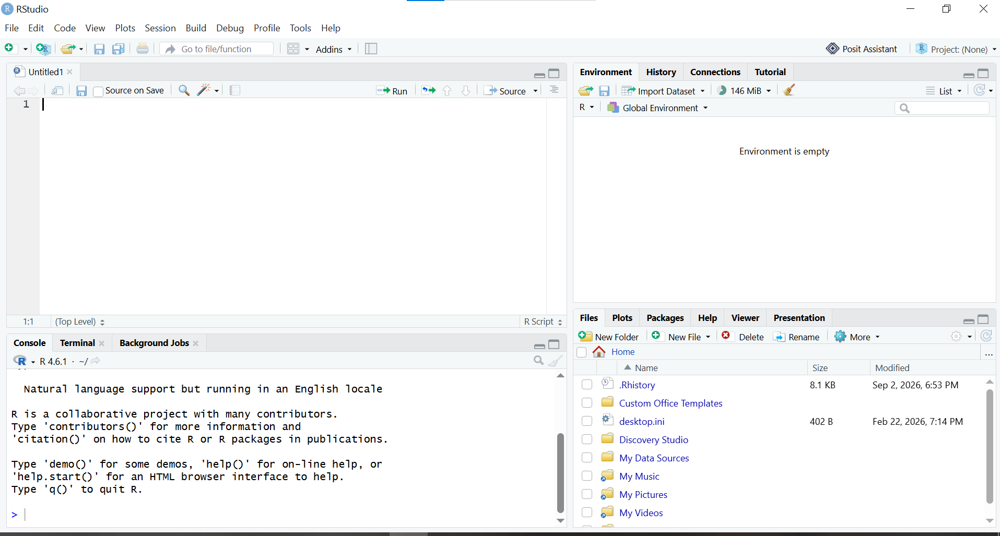

# Module 1: R Programming 

## Session 1 :  Introduction to R & Rstudio
### Objectives
- Install R and Rstudio
- Understand R exceution flow 
- Work with variables and basic data types 
- Perform basic input/output operations 

### Major uses - advantange 
- Used in statistics and bioinformatic 
- Open source 
- Good Packages available like ggplot2 (Used for visualisation)

### Download R
- Using CRAN-posit
- R --> interpretator
- Rstudio --> Interface

### Rstudio interface (interactive window)
| RStudio Panel | Function |
|---|---|
| Script Editor | Write and edit R code |
| Console | Execute commands and view outputs |
| Environment | Display stored objects, variables and datasets |
| Plots Panel | Display graphs and visualisations |



### To run a command 
- press ctrl + Enter -->selected line only runs 
- or click run or play --> on editor

### R execution flow 
- Flow of information is in this direction for python "-->"
- Flow of information for R is "<--"
- `x <- 10` means value 10 is assigned to x
- R executes line bye line 
- case senstive language 
- instead of variables R has a concept called "objects"
- objects stores values such as strigs, numbers, bool 
- it hits error if wrong syntax is used 

script in R --> IDE --> R interpreter --> Execution --> output in concole

apart from "objects" also has "variables"

Example: `age<- "Deepti"`
this is stored as values visible under the environment panel

### Data types in R
|Data type|Description|
|---|---|
|Numeric|Used for numbers|
|Character|Used for text|
|logical|Used for True/False values|
|Complex numbers|Used for imaginary numbers|
|Data frame|2D array|
|vector|1D array|

there are more data types that we will see in the upcoming sessions 

**To check what datatype a variable has:**
we can use the class function `class(variable_name)` --> Run function 

### Basic inbuilt input functions
`Readline()` --> takes user input, stores as character 
`print()` --> Displays output 
`Cat()` --> combines text, then prints object

Example: 
``` r
name<- readline("Enter name: ")
print(name)
Cat("hello", name)
```
### Library 
- collection of packages 
- most used library in bioinformatics is tidyverse
- tidyverse is used for data manupulation and visualisation 
- some of the packages in tidyverse commonly used are **readr, dplyr, ggplot2, tibble**

to search of packages under tidyverse 
```r
library(tidyverse)
search() #lists all the packages
```
|packages|description|
|---|---|
|readr|reads CSV and data files|
|dplyr|filtering, selecting, transforming data|
|ggplot2|creating graphs and plots|
|tibble|improved data frame structure|
|readxl|reads excel sheets|

### Built in Rstudio datasets 
Rstudio has buit in datasets that can be used for practices 
1. mtcars 
- To load the data --> `data(mtcars)`
- To show 1st 5 rows and columns: `head(mtcars)`
- Environment tab displays documentation about what it contains, objects, values, variables 

2. iris 
- This is a plant based dataset 

