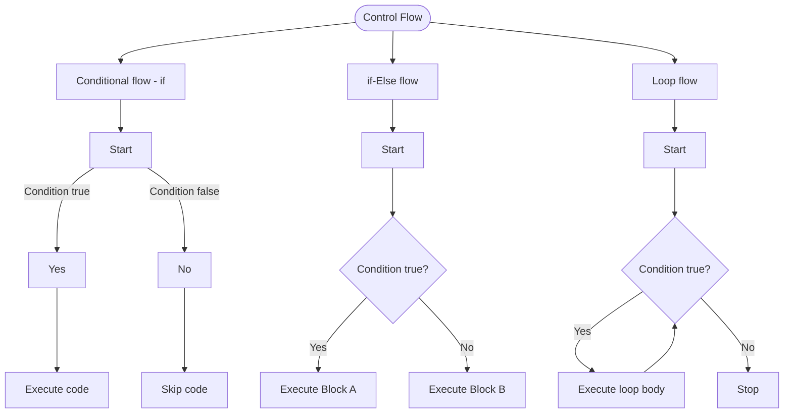

# Module 1: R Programming

## Session 2: Control flow and logical structures

## 1. Objectives
- understand conditional statements 
- apply logical operators 
- implement loops 
- translate biological problems into structured logic

## 2. Control flow 
- determines how R makes decisions and repeats actions 

